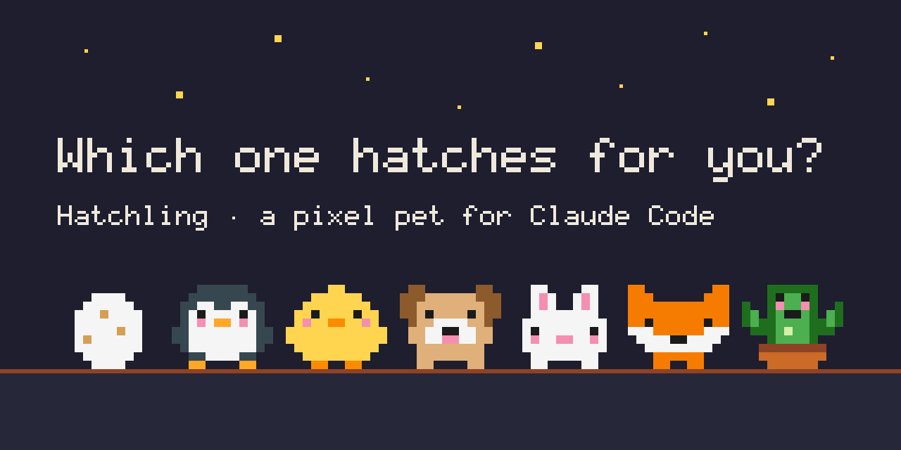
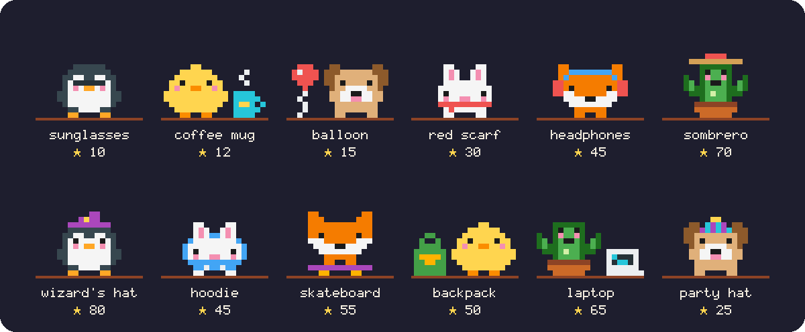
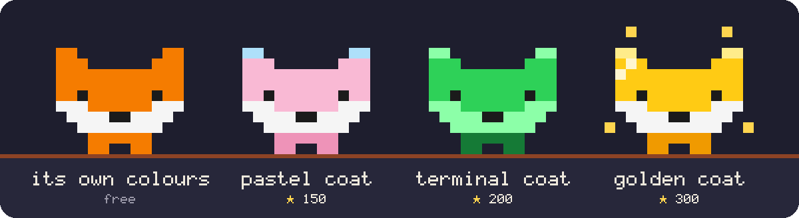
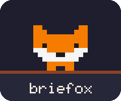

<p align="center">
  
</p>

<h1 align="center">Hatchling</h1>

<p align="center"><em>A pixel pet above your prompt, and one sentence that made a long session cost less.</em></p>

<p align="center">
  
  
  
  
  
  <!-- when the repository is public:
  
  -->
</p>

<p align="center">
  <a href="#install">Install</a> ·
  <a href="#the-pet">The pet</a> ·
  <a href="#briefox">briefox</a> ·
  <a href="bench/RESULTS.md">Results</a> ·
  <a href="#what-stays-on-your-machine">Privacy</a>
</p>

<table>
  <tr>
    <td align="center" width="25%"><h3>7</h3>animals to hatch<br><sub><a href="docs/pet.md">docs/pet.md</a></sub></td>
    <td align="center" width="25%"><h3>0 tokens</h3>unless you turn comments on<br><sub><a href="docs/privacy.md">docs/privacy.md</a></sub></td>
    <td align="center" width="25%"><h3>-12.7%</h3>cost of a long session with "Be brief."<br><sub>8+8 runs, Opus 5.5, p 0.0006: <a href="bench/RESULTS.md">Series 9</a></sub></td>
    <td align="center" width="25%"><h3>8 lines, 1 sentence</h3>the lines were not shown to beat the sentence<br><sub>two projects: <a href="bench/RESULTS.md">Series 8 and 9</a></sub></td>
  </tr>
</table>

<p align="center">
  <br>
  <sub>Drawn from the plugin's own sprites.</sub>
</p>

## Install

<p align="center">
  <br>
  <sub>A real recording of a first start.</sub>
</p>

Two plugins for Claude Code 2.1.275 or later. The pet:

```
/plugin install hatchling --marketplace silirim/hatchling
```

Had the pet under its earlier name? [docs/renamed.md](docs/renamed.md) moves it.

The sentence alone:

```
/plugin install briefox --marketplace silirim/hatchling
```

## The pet

<p align="center">
  
</p>

- It tells you which chats wait for you, those without Hatchling too.
- It keeps your reminders.
- It reports your day: chats, folders, turns, files changed.
- An egg hatches into one of seven animals; the seventh is rare, and not shown.
- It grows with use and never loses anything.
- It costs no tokens, unless you turn its comments on.

### Dress it

<p align="center">
  
  
</p>

Use earns stars. The shop takes them for things to wear, three coats and the other animals.

### Share it

<p align="center">
  
</p>

`/pet share` saves a picture like this one, with nothing about your work in it.

### Commands

| Command | What it does |
|---|---|
| `/pet` | the pet's card |
| `/pet pet` | pet it |
| `/pet shop [item]` | the catalogue; buy an item |
| `/pet wear <item>` | put on or take off |
| `/pet chats` | which chat waits for you |

<details>
<summary>More commands</summary>

| Command | What it does |
|---|---|
| `/pet diary` | the work report |
| `/pet remind <text>`, `/pet reminders` | reminders in the bubble |
| `/pet share` | a picture of the pet for a post |
| `/pet export`, `/pet import <path>` | move the pet to another computer |
| `/pet comments on\|off` | comments; off by default |
| `/pet model [alias\|id]` | comments' model; default `haiku` |
| `/pet briefox on\|off` | briefox's sentence, from the pet |
| `/pet hide`, `/pet show` | hide or show it |
| `/pet help` | every command |

</details>

The rest: [docs/pet.md](docs/pet.md).

## briefox

<p align="center">
  
</p>

One sentence in the system prompt: `Be brief.` ([briefox/text.js](briefox/text.js)). On as installed; `/briefox on|off` switches it.

We measured eight lines of advice against that sentence on two projects. The sentence did as well, so we ship the sentence.

<p align="center">
  
</p>

Whole headless sessions, Opus 5.5, 8 runs an arm, a long task on VodMax, the author's own project (Series 9):

| In the system prompt | Mean cost | Against nothing | p |
|---|---|---|---|
| nothing | $3.610 | | |
| `Be brief.` | $3.151 | -12.7% | 0.0006 |
| `Be brief.` and three lines | $3.210 | -11.1% | 0.0053 |
| the eight lines | $3.260 | -9.7% | 0.0022 |

- **No text is shown to differ from another.** The lines read 3.5% higher than the sentence (p 0.34).
- **On gin there is no arm without a plugin for "Be brief."**, so no saving figure: beside it the lines read 5.0% lower (Series 8, p 0.50, not shown).
- **ponytail cost less than the eight lines on gin**: 10.0% less (Series 7, p 0.0141). The sentence was not run against ponytail.
- **Short tasks showed no saving** for the eight lines. The sentence was not run on them.

Every run: [bench/RESULTS.md](bench/RESULTS.md). On your project: [bench/README.md](bench/README.md).

## What stays on your machine

- **Kept locally**, in Claude Code's plugin store (`~/.claude/plugins/store/`): the pet's counters and preferences, a diary of times, counts and folder names, your reminders (never exported or sent to the comments model; their command answers are chat lines), and for each chat the full path of its folder and the times of its last turn (30 chats, 30 days), and your live sessions' folders and statuses. Never the content of a chat, a prompt, a file or a command. briefox keeps only its switch.
- **Nothing is sent anywhere**, and no model is asked.
- **The one exception is comments, off by default.** A small model, on your tokens (about 650 in, 75 out; at most 40 a day), gets the pet's character and language, your name if told, why it speaks, tool names (MCP servers' too) and counts, failed programs' names, how many files changed, the assistant's last 600 characters, its last two lines, three diary lines with folder names, another finished chat's folder name and times and, with `/pet say`, your first 300 characters. A pause or resume sends a recap: up to 16,000 characters of the last turn's text, 300 of your last prompt.
- `/pet adopt` reads `~/.claude.json` once, when you run it. `/pet share` saves a picture in `~/.claude/hatchling-share/`. `/pet export` saves the pet there as a file you carry yourself.
- Complete: [docs/privacy.md](docs/privacy.md).

## Development

`npm test` needs only Node 20: [docs/development.md](docs/development.md).

## Licence

MIT: [LICENSE](LICENSE).
