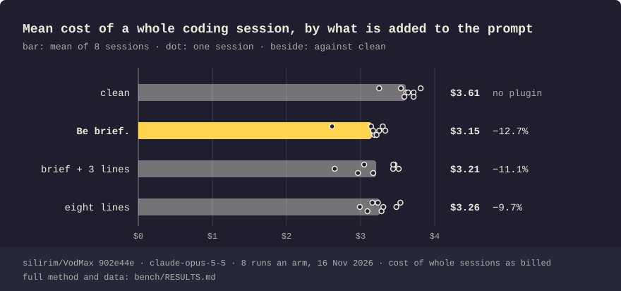

# Cachito


*Drawn from the plugin's own sprites.*

Two plugins for Claude Code: **Cachito**, a pixel pet that lives above your prompt, and **cachito-lean**, eight lines in the system prompt that make long sessions cost less.

## Install

Claude Code 2.1.275 or later.

The pet:

```
/plugin install cachito --marketplace silirim/cachito-pet
```

The eight lines alone:

```
/plugin install cachito-lean --marketplace silirim/cachito-pet
```

## The pet

- An egg hatches into one of seven animals: penguin, chick, dog, bunny, fox, cactus, and a rare seventh, not shown.
- It grows with use and never loses anything.
- Use earns stars; a shop sells things to wear, a golden coat and the other animals.
- It tells you which of your chats waits for you and which stopped.
- It can comment on your work, if you turn that on.
- It costs no tokens unless comments are on.


*A real recording of a first start.*

## Commands

| Command | What it does |
|---|---|
| `/pet` | the pet's card |
| `/pet pet` | pet it |
| `/pet shop [item]` | the catalogue; buy an item |
| `/pet wear <item>` | put it on or take it off |
| `/pet chats` | which chat works, waits or asks for your OK |
| `/pet share` | a picture of the pet to attach to a post |
| `/pet comments on\|off` | comments; off by default |
| `/pet lean on\|off` | cachito-lean's eight lines, from the pet |
| `/pet hide`, `/pet show` | put it away, bring it back |
| `/pet help` | every command |

The rest: [docs/pet.md](docs/pet.md).

## cachito-lean

Eight lines in the system prompt ask for short answers, the least code and read-only calls sent together. They are in [lean/style.js](lean/style.js).

`/lean on|off` switches them; on as installed. In a long chat a switch waits for the next compaction.

Our bench measured whole headless sessions with and without the lines: 8 runs an arm, 5 in the third row. VodMax is the author's own public project.



| Session | Model | Claude Code alone | With the lines | Difference | p |
|---|---|---|---|---|---|
| VodMax: long, read-heavy | Opus 5.5 | $3.649 | $3.107 | -14.8% | 0.0014 |
| VodMax: six real defects | Opus 5.5 | $3.360 | $2.943 | -12.4% | 0.0485, at the edge |
| VodMax: the same | Fable 5.2, low effort | $4.273 | $3.684 | -13.8% | 0.0238 |
| gin: six real defects | Opus 5.5 | $2.404 | $1.639 | -31.8% | 0.0002 |

- **It does not beat ponytail on gin**: ponytail saved 38.7% and cost 10.0% less than the lines (p 0.0141).
- **Short tasks showed no saving.**

Every run and its limits: [bench/RESULTS.md](bench/RESULTS.md). Run it on your own project: [bench/README.md](bench/README.md).

## What stays on your machine

- **Kept locally**, in Claude Code's plugin store (`~/.claude/plugins/store/`): the pet's counters and preferences, a diary of times, counts and folder names, and for each chat the full path of its folder and the times of its last turn (30 chats, 30 days). Never the content of a chat, a prompt, a file or a command. cachito-lean keeps only its switch.
- **Nothing is sent anywhere**, and no model is asked.
- **The one exception is comments, off until you say yes.** Each asks a small model on your own tokens, about 600 tokens a line, at most 40 lines a day. It gets the pet's character and language, your name if told (`/pet call me`), why it speaks, tool names (your MCP servers' too) and counts, the names of programs that failed, how many files changed, the last 600 characters of the assistant's reply, the pet's own last two lines, up to three diary lines, and another finished chat's folder name and turn times; diary lines can carry folder names too. With `/pet say`, the first 300 characters you typed.
- `/pet adopt` reads `~/.claude.json` once, when you run it. `/pet share` saves a picture in `~/.claude/cachito-share/`.
- Complete: [docs/privacy.md](docs/privacy.md).

## Development

`npm test` needs only Node 20: [docs/development.md](docs/development.md).

## Licence

MIT: [LICENSE](LICENSE).

## Not that Cachito

This one has no Bluetooth, and only vibrates with joy when your tests pass.
