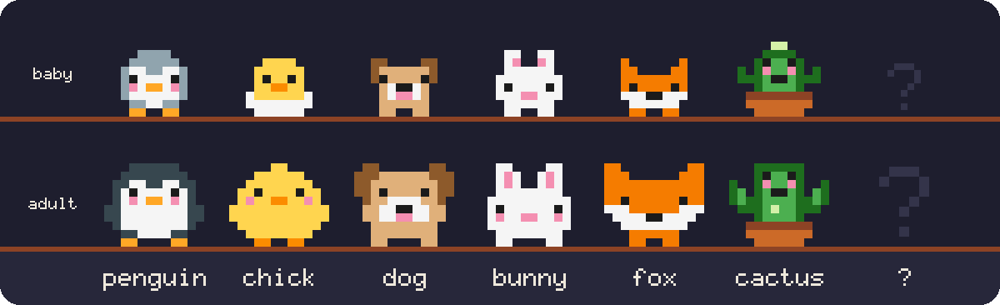
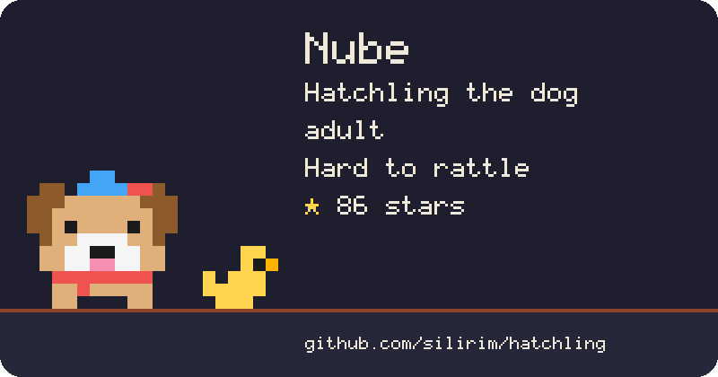

<p align="center">
  
</p>

<h1 align="center">Cachito</h1>

<p align="center"><em>A pixel pet above your prompt, and eight lines that make long sessions cost less.</em></p>

<p align="center">
  
  
  
  
  
  <!-- when the repository is public:
  
  -->
</p>

<p align="center">
  <a href="#install">Install</a> ·
  <a href="#the-pet">The pet</a> ·
  <a href="#cachito-lean">cachito-lean</a> ·
  <a href="bench/RESULTS.md">Results</a> ·
  <a href="#what-stays-on-your-machine">Privacy</a>
</p>

<table>
  <tr>
    <td align="center" width="25%"><h3>7</h3>animals to hatch<br><sub><a href="docs/pet.md">docs/pet.md</a></sub></td>
    <td align="center" width="25%"><h3>0 tokens</h3>unless you turn comments on<br><sub><a href="docs/privacy.md">docs/privacy.md</a></sub></td>
    <td align="center" width="25%"><h3>-31.8%</h3>session cost on gin with cachito-lean<br><sub>8+8 runs, Opus 5.5, p 0.0002: <a href="bench/RESULTS.md">Series 7</a></sub></td>
    <td align="center" width="25%"><h3>-12% to -15%</h3>on a second project<br><sub>VodMax: <a href="bench/RESULTS.md">Series 4 to 6</a></sub></td>
  </tr>
</table>

<p align="center">
  <br>
  <sub>Drawn from the plugin's own sprites.</sub>
</p>

## Install

<p align="center">
  <br>
  <sub>A real recording of a first start.</sub>
</p>

Two plugins for Claude Code 2.1.275 or later. The pet:

```
/plugin install cachito --marketplace silirim/cachito-pet
```

The eight lines alone:

```
/plugin install cachito-lean --marketplace silirim/cachito-pet
```

## The pet

<p align="center">
  
</p>

- An egg hatches into one of seven animals; the seventh is rare, and not shown.
- It grows with use and never loses anything.
- It tells you which of your chats waits for you and which stopped.
- It can comment on your work, if you turn that on.
- It costs no tokens unless comments are on.

### Dress it

<p align="center">
  
  
</p>

Use earns stars. The shop takes them for things to wear, three coats and the other animals.

### Share it

<p align="center">
  
</p>

`/pet share` saves a picture like this one, with nothing about your work in it.

### Commands

| Command | What it does |
|---|---|
| `/pet` | the pet's card |
| `/pet pet` | pet it |
| `/pet shop [item]` | the catalogue; buy an item |
| `/pet wear <item>` | put it on or take it off |
| `/pet chats` | which chat works, waits or asks for your OK |

<details>
<summary>More commands</summary>

| Command | What it does |
|---|---|
| `/pet share` | a picture of the pet to attach to a post |
| `/pet export`, `/pet import <path>` | move the pet to another computer, as a file |
| `/pet comments on\|off` | comments; off by default |
| `/pet model [alias\|id]` | comments' model; default `haiku` |
| `/pet lean on\|off` | cachito-lean's eight lines, from the pet |
| `/pet hide`, `/pet show` | put it away, bring it back |
| `/pet help` | every command |

</details>

The rest: [docs/pet.md](docs/pet.md).

## cachito-lean

<p align="center">
  
</p>

Eight lines in the system prompt ask for short answers, the least code and read-only calls sent together. They are in [lean/style.js](lean/style.js).

`/lean on|off` switches them; on as installed. In a long chat a switch waits for the next compaction.

Our bench measured whole headless sessions with and without the lines: 8 runs an arm, 5 in the third row. VodMax is the author's own public project.

| Session | Model | Claude Code alone | With the lines | Difference | p |
|---|---|---|---|---|---|
| VodMax: long, read-heavy | Opus 5.5 | $3.649 | $3.107 | -14.8% | 0.0014 |
| VodMax: six real defects | Opus 5.5 | $3.360 | $2.943 | -12.4% | 0.0485, at the edge |
| VodMax: the same | Fable 5.2, low effort | $4.273 | $3.684 | -13.8% | 0.0238 |
| gin: six real defects | Opus 5.5 | $2.404 | $1.639 | -31.8% | 0.0002 |

- **It does not beat ponytail on gin**: ponytail saved 38.7% and cost 10.0% less than the lines (p 0.0141).
- **Short tasks showed no saving.**

Every run and its limits: [bench/RESULTS.md](bench/RESULTS.md). Run it on your own project: [bench/README.md](bench/README.md).

## What stays on your machine

- **Kept locally**, in Claude Code's plugin store (`~/.claude/plugins/store/`): the pet's counters and preferences, a diary of times, counts and folder names, and for each chat the full path of its folder and the times of its last turn (30 chats, 30 days). Never the content of a chat, a prompt, a file or a command. cachito-lean keeps only its switch.
- **Nothing is sent anywhere**, and no model is asked.
- **The one exception is comments, off by default.** A small model, on your tokens (about 650 in, 75 out; at most 40 a day), gets the pet's character and language, your name if told, why it speaks, tool names (MCP servers' too) and counts, failed programs' names, how many files changed, the assistant's last 600 characters, its last two lines, three diary lines with folder names, another finished chat's folder name and times and, with `/pet say`, your first 300 characters. A pause or resume sends a recap: up to 16,000 characters of the last turn's text, 300 of your last prompt.
- `/pet adopt` reads `~/.claude.json` once, when you run it. `/pet share` saves a picture in `~/.claude/cachito-share/`. `/pet export` saves the pet there as a file you carry yourself.
- Complete: [docs/privacy.md](docs/privacy.md).

## Development

`npm test` needs only Node 20: [docs/development.md](docs/development.md).

## Licence

MIT: [LICENSE](LICENSE).

<p align="center"><sub><b>Not that Cachito.</b> This one has no Bluetooth, and only vibrates with joy when your tests pass.</sub></p>
