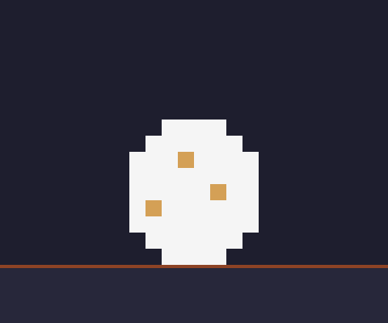

# Cachito



Drawn from the plugin's own sprites; the real thing sits above your prompt.

Two plugins for Claude Code in one repository, installed apart:

- **`cachito-lean`**: eight lines in the system prompt that ask for short answers, the least code and read-only calls sent together. On as soon as it is installed. Nothing is drawn, and nothing is kept until you turn it off.
- **`cachito`**, the pet: optional. A pixel pet above the prompt. It can switch the same eight lines (`/pet lean on`), and does not need the other plugin.

```
/plugin install cachito-lean --marketplace silirim/cachito-pet
```

```
/plugin install cachito --marketplace silirim/cachito-pet
```

## cachito-lean

The plugin adds one section to the system prompt, the text in [lean/style.js](lean/style.js), and does nothing else: no model is asked and nothing is sent anywhere. It reads the token count of each request, only to know when the chat is long.

| Command | What it does |
|---|---|
| `/lean` | says whether the lines are in the system prompt, and shows them |
| `/lean off` | takes them out |
| `/lean on` | puts them back |

A switch counts from your next prompt. In a chat that is already long (30k tokens of context or more) it waits for the next compaction or the next chat, and the answer says so: switching at once would send the whole conversation again, uncached.

### What our bench measured

The cost of whole headless sessions, the same requests with and without the lines, as the CLI bills them. Each row is its own experiment: the rows are not to be averaged. Every run, the method and the limits are in [bench/RESULTS.md](bench/RESULTS.md).

| Session | Model | Runs an arm | Claude Code alone | With the lines | Difference | p | Shown |
|---|---|---|---|---|---|---|---|
| long, read-heavy (`tour`, Series 4) | Opus 5.5 | 8 | $3.649 | $3.107 | -14.8% | 0.0014 | yes |
| six real defects to fix (`real`, Series 5) | Opus 5.5 | 8 | $3.360 | $2.943 | -12.4% | 0.0485 | at the edge: without one pair of runs, -10.6% and p 0.0752 |
| the same (`real`, Series 6) | Fable 5.2, low effort | 5 | $4.273 | $3.684 | -13.8% | 0.0238 | yes, on few runs |
| six real defects of gin to fix (`gin`, Series 7) | Opus 5.5 | 8 | $2.404 | $1.639 | -31.8% | 0.0002 | yes; ponytail cost less still, see below |


The limits, plainly:

- **It does not beat ponytail.** On gin (Series 7), the one series that ran this plugin alone next to the other two, the lines saved about a third against Claude Code alone (-31.8%), ponytail a bit more (-38.7%), and ponytail cost 10.0% less than these lines (p = 0.0141). caveman's saving there is not shown (-9.6%, p = 0.1021). On the long session (Series 1) caveman cost 12.0% less than Claude Code alone and ponytail 11.5% less, each shown, and no difference among the three is shown; the Cachito arm of that series was these lines together with a lever that is gone since.
- **gin is a project the model knows well**, and a third is the largest saving of any series here: one task, one model, and in three blocks of eight the agents of the four arms got in each other's way on the ports gin's tests use. Do not expect a third on your own work.
- **No saving is shown on short tasks.** On the two short ones (`fix` and `short`, sessions of about $0.50) no arm cost less than Claude Code alone by more than chance gives. The lines alone were not run there.
- **Series 4 to 6 loaded the pet with its lean on** (the arm `style`), not this plugin alone; Series 7 loaded this plugin alone (the arm `leanonly`). The text sent is the same, from the same file.
- Two projects (VodMax, a public Go project of the author, and gin), two models, sessions with no person in them. A saving in your own chats is not shown by this.

## The pet (optional)

A pixel pet for Claude Code (Codex is planned) that keeps you company, grows fond of you as you use it, and points out where a session wastes tokens without ever punishing you for it.

The band above the prompt shows the pet, with one dim row for its name, its stars and its own buttons (`Tobo  ★ 29  ·  skin  pet`; the `[-]` at the right end is Claude Code's own and folds the band; `/pet hide` puts the pet away, `/pet show` brings it back), and its speech bubble when it has something to say, with the buttons of the phrase under it. A phrase stays about 12 seconds (longer when it is long or has a button of its own, never over 30; a question stays until your next prompt), then the bubble goes and only the pet is left, with that row beside it and no row of buttons under it, so the band is as tall as the drawing, until there is something new to say. The band follows the width it has: in a narrow terminal the bubble narrows and wraps, then the buttons go, then only the pet is left with its name and stars, and under the width of the drawing one row of text. The row of the name is never wider than the room it has: when it is too wide, the pet's own buttons go first (`[-]`, then `pet`, then `skin`: each has a command), then the count of your other chats, and the name is cut last. A calm pet moves a little, rarely: a look towards the chat, to the other side or up, a flick of the ears (or of the wings, flippers or arms), a hop of one pixel, never while a phrase is up and never more than one in 8 to 20 seconds. The count is live: it moves when a turn or a cuddle brings stars and when the shop takes some. Hearts and humour are on the `/pet` card only. It watches the session locally and, as installed, adds nothing to the model's context: zero tokens. **The pet never loses anything**: there is no health, it is never knocked out and never sick. What it notices is a note above the prompt, a friend's advice that costs nothing: a long chat (about 60k tokens of context or more) without lean, a file re-read unchanged, a command that failed three times in a row, a rebuilt or expired cache, a nearly full context. Where a remedy exists, a `fix` button puts it in the prompt box, and each case has a [guide](docs/fix/). For the long chat the remedy is `/pet lean on`. Lean is the style: a few lines added to the system prompt. In our bench the style alone cost 14.8% less on one long task (Opus 5.5, 8 runs, p 0.0014, Series 4 of [bench/RESULTS.md](bench/RESULTS.md)). On a second task, six real defects to find and fix in one chat, it read lower twice with weaker evidence: -12.4% on Opus 5.5 (8 runs, p 0.0485, at the edge of the threshold and not shown without one pair of runs) and -13.8% on Fable 5.2 at low effort (p 0.0238, only 5 runs an arm); the defects got fixed in both arms. The two short tasks were run with the style and the diet together, never the style alone, and showed no saving; your chats may differ. In a chat that is already long the style waits for the next compaction or chat, and the pet cheers when the style is in.

## Affection, stars and the shop

- **Hearts are affection**, shown on the `/pet` card. They fill with ordinary use and with cuddles (at 10, 50, 150, 300 and 500 of affection) and never empty, whatever you do or do not do. The humour is `happy` for 2 hours after a cuddle or from the 10th turn of a day, `calm` otherwise: never sad, and no line ever remarks on your absence. Back after 3 days or more, the pet welcomes you with 10 stars.
- **Growth** follows the days you used the pet on and the affection gathered: grown up at 3 days and 60 affection, the crown at 20 days and 500. Not the cache, not how lean a chat was.
- **Stars**: 1 per turn ended (the first 30 of a day), 2 per cuddle (the first 3 of a day), 5 at the first use of a day. Each of these stars is also one of affection; using stars in the shop never lowers affection. No streak of days, no timer, no random prize.
- **The shop** sells things to wear and nothing else: none changes what the pet does. `/pet shop` shows the catalogue, `/pet shop <item>` buys, `/pet wear <item>` puts on. The pet wears one thing on each part at once: `head` (cap, headphones, sombrero, and the crown), `face` (sunglasses), `body` (scarf), `feet` (sneakers, or a skateboard it stands on) and one `accessory` on the ground next to it (mug, lamp, backpack, suitcase). A new thing takes the part of the one that was there. They are drawn on every stage and under every note; asleep the pet wears nothing. The crown is not sold: a pet grown to its last stage has it, and wears it unless you take it off or pick a hat.
- **The golden coat** is a colour and nothing else: it turns any animal to a deep gold, at every stage, with a pale glint on it and a sparkle that lights up next to it now and then, and changes nothing the pet does. One pet in a hundred is born with it, for nothing; any other can buy it (`/pet shop golden`, 300 stars, the last row of the shop). Who has it picks between `golden` and `plain` on the `coat` part of the skin menu, or with `/pet wear golden` and `/pet wear plain`.
- **Animals**: the animal your pet was born as is free and always yours. Each of the other five common ones (penguin, chick, dog, bunny, fox, cactus) is unlocked once for 100 stars (`/pet shop <animal>`, in a section of its own in the shop) and then stays yours: `/pet animal <name>` or the `animal` part of the skin menu switches freely among the ones you have. A pet from before the prices that is shown as another animal than its own keeps both. A seventh, rare one is not shown here: only a pet born as one has it, and it is not sold.
- **Skin packs**: more animals, things to wear and coats from JSON files you put in `~/.claude/cachito-skins/`. They are data, never code, checked before use, yours at once and free; `/pet skins` lists them. `npm run skin:import` turns a Codex pet you have on disk into one. Format, an example to copy and the importer: [docs/skins.md](docs/skins.md).
- **One count of stars for all your chats**, read again before every purchase. If two chats still spend the same stars in the same instant, both things stay yours and the balance goes under zero: nothing more can be bought until use brings it back to zero.

| Item | Stars | | Item | Stars |
|---|---|---|---|---|
| `shades` sunglasses | 10 | | `headphones` | 45 |
| `mug` a coffee mug | 12 | | `backpack` | 50 |
| `scarf` a red scarf | 30 | | `suitcase` | 60 |
| `cap` a travel cap | 30 | | `sombrero` | 70 |
| `lamp` a desk lamp | 40 | | | |

Every number above is in `RULES` in [engine/engine.js](engine/engine.js). A pet from a version before the shop keeps its name, seed, character, animal and cuddles; its old counters (health, knock-outs, efficient sessions) are dropped at the first write, and the accessories it had unlocked are owned.

| Command | What it does |
|---|---|
| `/pet` | the pet card: stage, hearts and humour, the character with its five statistics, affection and days of use, stars and what it owns, whether lean is on, whether comments are on, with its lines and cost today and its cost in all |
| `/pet audit [days]` | the receipt: where the money of your sessions went (context carried, output, subagents, cache breaks), read from your local transcripts |
| `/pet lean <on\|off>` | off by default: turns the style on or off, and nothing else. The style adds a few lines to the system prompt (short answers, the least code, read-only calls sent together). The pet counts as lean the style in the system prompt, and nothing else. In a chat that is already long the style waits for the next compaction or chat. `/pet style <on\|off>` does the same. With `cachito-lean` installed too the lines are sent once, and are there while either of the two has them on. The pet sees them there: with its own switch off and `cachito-lean` on, its card says `lean on: the style, by the cachito-lean plugin`, a long chat gets no `lean off` note, and `/pet lean` says that `/lean off` is what takes them out |
| `/pet comments <on\|off>` | off by default: lets a small model write one short line about the turn. It spends tokens of your own account and sends a short summary of the turn to the model: see [Comments](#comments-off-by-default) |
| `/pet say <text>` | speak to the pet: it answers in its bubble with one line in its character. With comments on the text you write goes to the small model; with comments off it says a fixed line. Not a turn of the chat: see [Talking to the pet](#talking-to-the-pet) |
| `/pet diary` | the pet's diary, whole: milestones, habits and recent days, written by the mod on your machine. `/pet diary clear` empties it: see [The diary](#the-diary) |
| `/pet lang <en\|es\|pt\|zh>` | the pet's language: English, Spanish, Portuguese or Simplified Chinese: see [Languages](#languages) |
| `/pet animal <name>` | switch to an animal you have: the one your pet was born as, and the ones unlocked. The name and the character stay. With no name it lists yours and the ones still to unlock |
| `/pet skins` | list the skin packs found in `~/.claude/cachito-skins/`, what each brings, and the faults of the ones left out ([docs/skins.md](docs/skins.md)) |
| `/pet name <name>` | rename the pet: letters of any script with their marks, digits, spaces, up to 20 columns on screen |
| `/pet pet` | pet it: hearts for a couple of seconds, a short line, and for the first three of a day 2 stars. The band has a `pet` button that does the same |
| `/pet adopt` | take the name and personality of your old `/buddy`, if your Claude Code config still has one |
| `/pet shop` | the catalogue with prices, your stars and what you own |
| `/pet shop <item>` | buy an item with stars; it is worn at once (`/pet buy <item>` does the same) |
| `/pet wear <item>` | put on something you own, on its part; the same again takes it off; `/pet wear none` takes everything off; `/pet wear plain` and `/pet wear golden` pick the coat |
| `/pet skin` | each part you have something for, with what is on it. The `skin` button on the band opens the same parts as buttons (`head`, `face`, `body`, `feet`, `accessory`, `coat`, and `animal` when you have more than one, then `done`): a press turns that part to the next thing you own for it, and after the last one to nothing |
| `/pet hide`, `/pet show` | hide or show the band. Hidden, the pet asks the small model for nothing |
| `/pet chats [on\|off]` | your open Claude Code chats: which is working, which waits for you, which may be waiting for your OK, and since when. Folder names and times only. On by default: see [Which chat needs me](#which-chat-needs-me) |
| `/pet help` | the list of the commands, in the pet's language. A word that is no command says so in one line |

What the bench has shown about the levers, what it has not, and every run behind it: [bench/RESULTS.md](bench/RESULTS.md).

## After a long pause

Cachito gives one piece of advice about the cache, and does nothing on its own. When you send a prompt after a pause of more than an hour and the chat holds 100k tokens or more, the bubble says the cache has expired and that restarting small costs less. A `fix` button puts `/compact` in the prompt box; `/clear` is the choice if the task is done. Under 100k it says nothing.

- The hour is an assumption. According to the documentation the cache lasts 1 hour on a subscription and 5 minutes with an API key. The mod cannot tell which one you have, so it uses 1 hour, the cautious side: with a 5 minute cache the advice comes late, or not at all.
- The advice comes with the prompt you just sent, so that request already carries the whole chat. It is about the requests after it.
- Claude Code already compacts on its own, when idle, a chat over 200k tokens.
- There is no context budget and no automatic compaction in Cachito. Earlier versions had `/pet budget`. No valid run of ours measured it: the early runs had other plugins loaded and are not evidence. What is left is a sum on paper from the price list, which said that on a large model a compaction costs more than the re-reads it spares; it is an estimate, not a measurement. A budget saved by an earlier version is ignored, and removed from the preferences the next time they are written.

## A companion, not only a gauge

Cachito also talks a little. As installed, everything it says is text written in the mod and shown on your screen: it adds no tokens to the model's context and asks no model. (The one exception is [comments](#comments-off-by-default), which you turn on yourself.) Where a line comes with a button, the button only fills the prompt box, and nothing is sent until you press Enter.

- **A greeting** when a chat opens, one line: a chat left in this folder lately (`a chat here stopped mid-turn 20 min ago. pick it up?`, with a `resume` button that types `/resume`), a return after 3 days or more (a warm welcome and 10 stars), the first chat of the day, a folder it has seen, or a new one.
- **Another chat finished a job**: with two chats open, the one you are using says when the other ended a turn of 2 minutes or more, the kind you were waiting for: `the chat in vodmax finished its job just now`, with the folder of that chat and since when. A short turn is no news, the same chat is not told again within 10 minutes, and no news comes more often than every 5. With [comments](#comments-off-by-default) on the small model says the same in the pet's character.
- **Clearer notes on failing commands**: which program, how many times in a row, over how many turns (`npm failed 4 times in a row, over 2 turns`). A turn of 2 minutes or more in which at least two things went wrong ends with a recap (`long turn: npm failed 4 times, git failed once, 2 re-reads`). Programs are named, their arguments never.
- **An outline for a long chat**: from about 60k tokens of context, lean on or off, it offers once to put your thoughts in order. The `outline` button writes a request for the agent: where we are, where we need to get to, what is still missing, fit to paste into a new chat. It is offered again only after 15 more turns. No saving is claimed for it: none was measured.
- **`coffee break?`** after 20 turns in a row in one sitting (a 15 minute pause ends a sitting), at most every 90 minutes.
- **A word of nonsense**, rarely: one or two words like `6 7` or `aura`, about one calm turn in 25 and never within 12 turns of the last.

It does not chatter: one greeting, then a line only when there is something new, at least 3 minutes apart. A warning always comes first: while a note, a long chat without lean, or an expired cache holds the bubble, only the recap and the outline offer are shown, on a second line, and the rest is not said. The thresholds are in `RULES` in [engine/engine.js](engine/engine.js), the lines in [engine/catalog.js](engine/catalog.js).

## Comments (off by default)

As installed the pet says fixed lines only, and nothing is sent anywhere for it. It asks once whether it may comment: right after it hatches (or at the first start of this version, for a pet born before), the bubble says `May I comment on your work? It uses a small model on your account, at most about $0.00280 a day, and sends it a short summary of the turn. Details: /pet comments`, with two buttons, `comments on` and `stay quiet`. The figure is the day's cap at what a line costs (measured on your own lines once there are some). The answer is kept. Unanswered, the question goes with the next prompt you send, comments stay off, and no later chat asks again; a chat that offers to adopt an old /buddy leaves the question to the next start. Headless runs and the bench are never asked. `/pet comments on` lets a small model write one short line in the pet's character: a reaction to what just happened in the turn, in the first person, not a report of it. The five statistics are given to the model with their values and with what they mean together (which one leads, which comes second, which is the weak point), so a curious and jumpy pet asks and startles (`Oops, a missing folder. Did we startle it?`) where a dry one understates. `/pet comments off` goes back to the fixed lines. Turning it on answers with everything below, with your own figures.

**It spends tokens of your account.** Each line is one request to a small model (the alias `haiku`, through Claude Code's own client and credentials: `$.model.complete`), asked with the lowest effort and a reply cap of 30 tokens. Claude Code 2.1.323 does not hold that cap (in our probe a cap of 5 gave 18 tokens, and a cap of 40 gave 299), so what keeps a reply short is the prompt, and the count below is what tells you what was spent.

**What leaves your machine, with comments on, for each line:**

- a system prompt of six lines: the pet's name, its animal with the parts of its body (so it never speaks of ears or paws it does not have), its five statistics with their values and how they sound together, three sample lines in the tone of its highest statistic, and the rules of a line (a reaction in the first person, about six words and never more than 8, plain English, or the pet's language (see [Languages](#languages)), no file names, no paths, no quoted text, no exclamation marks, no emoji, no advice, never unkind to you);
- a summary of the turn made on your machine: why the pet speaks, the names of the tools used with how many calls each, the program names of the commands that failed (`npm`, never `npm run deploy --token ...`), how many files changed, and **the last 600 characters of the assistant's reply**, given as background (for a line during a long turn: how many minutes the turn has lasted, the counts so far, and the last 600 characters of what the assistant wrote last in that turn, when it wrote anything yet); the pet's own last two lines, so that the next one begins and sounds different; and at most three lines of [the diary](#the-diary), as memories it may hint at: times, counts and a folder's name, such as `works most often in cachito (a habit)`;
- when another of your chats ends a turn of 2 minutes or more: the name of that chat's folder (its last part only), how long the turn took and how long ago it ended, and nothing of what was in that chat;
- when you write `/pet say <text>`, that text, up to its first 300 characters: see [Talking to the pet](#talking-to-the-pet).

**What the pet itself never sends:** the content of a file, the output of a command, the arguments of a command, a file path, your prompts to the assistant. The names of the tools used do go, those of your MCP servers among them. The pet's last two lines are kept in the store and go back to the model in later chats too. Mind the last item of the list above: the end of the assistant's reply is sent as it is, so if the assistant quoted a file or your words there, that quote goes with it. With comments off none of this is sent.

**When it speaks:** at the end of a turn, at most one line every 10 minutes; without that wait when a command or a test failed in the turn, when the turn changed 5 files or more, and when you pet it: each of those has a short wait of its own since the last line for the same reason (30, 30 and 20 seconds), so a burst of failures or a slow connection never sends a volley. With the band hidden (`/pet hide`) no line is asked for at all. A line is counted in the day's 40 when it is asked for, before the call goes out, so two chats cannot pass the cap together, and a call that fails or runs out of time is counted too. The files counted are the ones the assistant's edit tools changed (Edit, Write, NotebookEdit): files changed by a shell command are not seen, so such a turn is an ordinary one and keeps the 10 minutes. **During a long turn too:** a long job of the assistant is one turn, so once a turn has run for 10 minutes the pet may say a line about it so far, and then no more than one every 10 minutes. The wait is the same one, shared with the lines at the end of a turn and counted over all your chats, so a turn that ends within 10 minutes of such a line gets none (unless a command failed or 5 files changed). Never more than 40 lines a day, over all your chats. Never while you type: nothing is asked while the prompt box holds text, and a line that comes back while you type waits for an empty box. It never blocks: the call is not waited for, and one that fails or takes more than 4 seconds is dropped, so the fixed line stays. A recap or the outline offer keeps the bubble, and the comment about the same turn is shown under it, as the last, dim line. The line about a cuddle is not kept on screen: it holds the bubble for 5 seconds over any other line, then what was there is back. In a headless run (`claude -p`) and under the bench comments are never used.

**What is shown:** the reply's first line, with escape sequences, invisible characters, emoji, quotation marks and exclamation marks taken out, and never more than 120 characters. A line wider than 60 columns on screen (a Chinese character takes two, so 30 of them) is never cut: it is not shown, the fixed line stays, and the call is paid and counted all the same (`/pet comments` says how many). The same goes for a line that names a file or a path (`src/app.js`, `/etc`; not "50/50" or "and/or"), and `/pet comments` counts those too.

**What it costs:** about $0.00007 a line, so the cap of 40 lines is about $0.003 a day. That is the average of 12 live lines (13 November 2026): 567 tokens in and 19 out each, at Haiku 5.5's list price ($0.10 and $0.50 per million). Until a line is paid for on your machine that figure is shown as an estimate; after the first line `/pet comments` shows your measured average instead, and the `/pet` card shows the lines and cost of today and the cost in all. The tokens are the ones each call reports; the dollars are an **estimate**: those tokens at Haiku 5.5's list price, since the call reports neither a price nor the model the alias came to. If the alias `haiku` leads to another model on your account, the real cost differs, and `/pet comments` says so too.

The numbers are in `RULES` in [engine/engine.js](engine/engine.js) (`voice...`: in the code and the store the feature keeps its first name, the voice), the prompts in [engine/voice.js](engine/voice.js).

## Talking to the pet

`/pet say <text>` speaks to the pet, and it answers in its bubble with one line in its character, held to the same width as a comment. With comments on, **what you write after `/pet say` is sent to the small model** (its first 300 characters), with the pet's character, its language and at most three lines of the diary. It is a request to the small model, not a turn of the assistant: the mod answers the command when you press Enter and drops it, so neither your words nor the answer become a row of the chat, and nothing is added to the chat's context. It counts in the day's 40 lines, without the 10 minutes' wait. Nothing of what you wrote is kept.

The pet is a pet: it gives no technical advice and does no work. Asked to fix or write something, it says in its own way that this is the assistant's job. With comments off no model is asked: it says a fixed line in its character, with what talking takes under it (`To talk, turn them on: /pet comments on. What you write then goes to a small model, on your tokens.`). When no usable line comes back it also says a fixed line. At the day's cap the fixed line says so plainly, in its character (`comments sold out today. restock tomorrow`), and so does the line of a cuddle (`pat noted. comments sold out till tomorrow`); `/pet comments` shows how many lines are left today.

## The diary

The pet keeps a short diary, written by the mod itself in its store on your machine: no model writes it, zero tokens. At most 40 lines, the oldest go. It holds **times, counts and folder names only**: never a failed command, an error, or the text of a prompt, a file or an answer.

- **Milestones**, written once: the first day together, the first thing bought, each stage it grows to, 10, 50 and 100 cuddles, a week, a month and 100 days together.
- **Habits**, drawn from counters and rewritten when they change: the folder you work in most, the time of day you are usually here (night, morning, afternoon, evening), how long a sitting usually lasts, the longest day so far.
- **Recent facts**: a long day (3 hours at work or more), a return after 3 days or more, a folder new this week.

The pet uses it in its fixed lines, at most one memory a day, in place of a plain greeting: `a month that we know each other`, `here again in the evening`, `cachito again, our usual place`, each said in its character and in its language. The days away are written down and never said aloud. `/pet diary` shows the whole diary with the counters the habits come from; `/pet diary clear` empties it. With comments on, the two or three lines that bear most on the moment go to the small model as memories it may hint at. A headless run and the bench keep no diary. The rules are in [engine/diary.js](engine/diary.js).

## Languages

The pet speaks English, Spanish, Portuguese and Simplified Chinese: `/pet lang <en|es|pt|zh>` picks one, and a newborn takes the language of your system (`LC_ALL`, then `LANG`) when it is one of these. The choice is kept and holds in every chat. What is translated is what the pet says in its bubble, the buttons, and the short replies of commands (the card, the shop, the diary); command names, the style sent to the model, the longer explanations and the documents stay in English. With comments on the model is told the language and answers in it. To add a language, copy [engine/lang/en.js](engine/lang/en.js) to a file of its own, translate the values, and list it in [engine/lang/index.js](engine/lang/index.js): `npm test` checks that it has every key, no exclamation mark, and no line wider than the bubble (44 columns, counted as they are on screen). A key a language lacks is said in English.

## A name and a character

Every pet has a name and a character, and neither costs a token: no model is asked for them. The name is put together from syllables, from a random seed drawn once and kept (`engine/persona.js`). The character is five statistics from 0 to 100, set at birth by the same seed and never changed: `WIT`, `CURIOSITY`, `CALM`, `RIGOR`, `WARMTH`. One is the peak and one the weak point. The `/pet` card shows each with a short bar, under one line of personality made from the two extremes:

```
character: Pokes at everything, and jumps at every red line.
  WIT       ██████░░░░  57
  CURIOSITY █████████░  91  peak
  CALM      ██░░░░░░░░  20  weak point
  RIGOR     ███████░░░  66
  WARMTH    █████░░░░░  54
```

The pet's voice has two characters. The highest statistic says most lines; the second highest says some, the more often the closer the two values are: about half the lines when they are equal, one in twenty when they are 36 points apart or more (`speaker` in `engine/persona.js`, `RULES.voiceSecond`). The fixed lines (`VOICE` in `engine/catalog.js`) are written five times, so each character says the same thing its own way, always short and never with an exclamation mark. Lines that carry a number or a name are said the same by all. The name opens the greeting; name and character outlive `/clear` and a change of animal. A pet born when the character was two traits keeps its name and seed, and the traits became its statistics: the first is the peak.

You can pet it, with `/pet pet` or the `pet` button: hearts rise along its sides for a couple of seconds and it answers in its character. Cachito counts the cuddles and remembers the last one. The first three of a day bring 2 stars and as much affection each, and it is `happy` for two hours.

Cachito never opens `~/.claude.json` by itself. Once, under its first greeting, it says that who had the old `/buddy` can take its name and character back with `/pet adopt`, and it says so without reading anything. Only when you run `/pet adopt` is the file read: **whole, at that moment** (it also holds your account data and the secrets of your MCP servers), and three fields of it are kept (`name`, `personality`, `hatchedAt`). The rest is dropped at once, and the file is never written. The animal stays the one you have: `/buddy` did not keep its species in that file. The personality is shown on the card as written, and its words set the peak of the statistics when they fit.

At the very first start the pet is an egg: it rocks, cracks, and after 8 seconds the animal rolled for you comes out. It happens once; `/pet demo` shows the egg again.

## Which chat needs me

With several Claude Code chats open, the pet tells you which one needs you. Each chat is in one of four states:

- **working**: a turn is running;
- **waiting**: its turn ended and you have not written yet;
- **asking**: the agent was told to ask your leave for a tool call, and the call has not started 5 seconds later, so a permission dialog is probably waiting for you there. It is worded as "may be waiting for your OK", because the mod sees the verdict (`ask`, with a person to answer it) and not the dialog itself: a rule or a classifier that answers within those seconds is never counted;
- **closed**: it ended, or it has not said it is alive for 90 seconds (a chat that dies says nothing).

What you see: beside the name and the stars, a short count of your **other** chats, only when there are any (`Tobo  ★ 29  ·  2 working · 1 waiting  ·  skin  pet`; in a narrow band the count gives way first, then the stars, then the buttons). When another chat ends a turn of 2 minutes or more, or may be waiting for your OK, the pet says so once in its bubble, with the folder's name: `the chat in api may be waiting for your OK`. Never about the chat you are in. `/pet chats` lists them: folder, state, since when.

It costs no tokens: the lines are fixed ones. With [comments](#comments-off-by-default) on, the small model may word the news in the pet's character, under the same cap and waits as any comment, and never with the band hidden. `/pet chats off` works both ways, from the moment you run it: your other chats **no longer see this chat** (they take it for closed, at once), and this chat **no longer sees them** (no count beside the name, no news, no list). The answer to the command says so. The chat still leaves the mark it always left (its folder and when its turns start and end), with no sign of life. `/pet chats on` turns it back on.

**What is kept for it**, in the mod's own store, one key for each chat (`chat.<id>`), written by that chat alone: the **full path of its working folder**, when its last turn started or ended, whether it ended, how long it lasted, when it last said it was alive (every 20 seconds while it is open), and since when a call has been waiting for your leave. Not which tool or command it was, and nothing of a prompt or a file. A mark is kept for 30 days, and no more than the 30 newest; the older ones are deleted when a chat starts. Under the bench and in a headless run no mark is left. The clock is not trusted blindly: a mark dated after now is not believed, and one set back does not come alive again.

## What it keeps

As installed nothing leaves your machine; with [comments](#comments-off-by-default) on, what that section lists does. Cachito keeps counters (affection, days of use, stars, what the pet owns, token totals) and, for the greeting and the news of other chats, one mark per chat in the mod's own store: the working folder, the time its last turn started or ended, whether that turn ended and how long it lasted. Never the content of a chat, a prompt or a command. One path is kept: the **full path of the working folder** of each chat, in those marks, for up to 30 chats and 30 days; it is how the pet tells that a chat was left in this folder. In the session's own memory, which other plugins could read, it keeps no path and no command line: only prints (hashes) of the files read and of the commands that failed, to tell a re-read or a loop. There is one pet for all your chats: each chat open reads the store before it writes and puts in only what it changed, so two chats side by side share one count of stars and one affection, and a choice like `/pet lean on` made in one reaches the others within seconds. Each preference (what the pet wears, the language, lean and the others) is kept under its own key, and a chat writes only the one you changed in it: a chat left open with an older picture of them cannot undo a choice made in another. With the preferences it keeps the pet's seed, name, character and language, [the diary](#the-diary), how many times you petted it and when the last time was, the comments' count (lines and cost of today and in all, tokens, the time of the last line, its last two lines) and, after an adoption, the three `/buddy` fields above; nothing else of `~/.claude.json` is read into it. The 30 newest marks are kept, for 30 days at most; a headless run (`claude -p`) leaves none.

**Two commands of earlier versions are gone.** `/pet diet` trimmed long command outputs and showed no saving in our bench (alone -3.6%, p 0.31); `/pet weight` listed what every request carries, which `/context` in Claude Code already shows. Each now answers with one line saying so. Nothing is written to `~/.claude/cachito-out` any more; the outputs the diet saved there before stay until you delete the folder, and they can hold anything a command printed, secrets included.

Status: work in progress. The Claude Code mod works; Codex support is planned, not there yet.

Install in Claude Code (2.1.275 or later): the two lines at the top of this page, one for each plugin.

Develop:

```
npm test          # engine rules, and the two plugins loaded together (engine/together.test.js)
npm run test:mod  # validate and test both plugins
npm run typecheck # types: the mod, then the Node scripts (audit, skin:check, skin:import, bench) with Node's
npm run sprites   # rebuild sprites/zoo.json, zoo.js and the icon
npm run skin:check <pack.json>        # check a skin pack with the mod's own rules
npm run skin:import <Codex pet folder> # turn a Codex pet into a skin pack
```

On a fresh clone `npm run typecheck` needs the mod's types, which are not in the repository: Claude Code writes them into `.claude-plugin/types/` when it loads the mod. Start it once from the clone with `claude --plugin-dir .` (2.1.275 or later), close it, then run the typecheck. `npm test` needs nothing but Node 20. The typecheck also needs `npm install` first (TypeScript and Node's types, exact versions in `package.json`); `package-lock.json` is deliberately not in the repository, because Claude Code's plugin installer installs every package a lockfile lists, and an installed plugin must pull nothing from npm.

The repository's root is the pet's folder, and `lean/` inside it is the other plugin, whole: `claude --plugin-dir .` loads the pet, `claude --plugin-dir lean` loads cachito-lean, and both flags together load both. The eight lines are written once, in `lean/style.js`, which the pet imports.

## Not that Cachito

This one has no Bluetooth, and only vibrates with joy when your tests pass.
